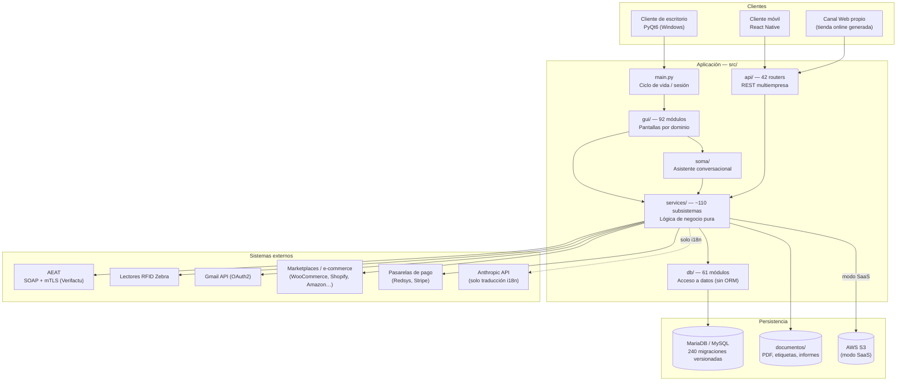

# Memoria Técnica Descriptiva — Smart Manager AI

**Documento preparado para depósito voluntario ante el Registro de la Propiedad Intelectual
(Derechos de Autor sobre obra de software), conforme al Real Decreto Legislativo 1/1996, de 12 de
abril, por el que se aprueba el Texto Refundido de la Ley de Propiedad Intelectual (LPI), Título
VII (Programas de Ordenador).**

| Campo | Valor |
|---|---|
| Denominación de la obra | Smart Manager AI |
| Tipo de obra | Programa de ordenador (software) — sistema de gestión empresarial integral |
| Autor / Titular | Mohamed Assbai Ahammar (NIF: 54579469D)
| Fecha de esta memoria | Septiembre de 2026 |
| Lenguaje predominante | Python 3.11+ (backend/escritorio), TypeScript/React Native (cliente móvil) |
| Volumen del código fuente | ≈ 195.500 líneas en 1.512 ficheros Python (`src/`) + ≈ 7.360 líneas en 51
ficheros TypeScript/TSX (`mobile_client/src/`) — medición directa sobre el repositorio a fecha de
esta memoria |
| Naturaleza | Obra original, de creación propia, no derivada de software de terceros salvo las
librerías de terceros de código abierto listadas en el apartado 2.2, utilizadas conforme a sus
licencias respectivas y sin incorporar su código fuente al repositorio propio |

---

## 1. Título y descripción general del software

### 1.1 Denominación

**Smart Manager AI** (también referido como «Smart Manager» en el uso comercial).

### 1.2 Naturaleza y finalidad

Smart Manager AI es un **sistema de planificación de recursos empresariales (ERP) integral**,
diseñado originalmente para el sector de almacén/retail y ampliado hasta cubrir la práctica
totalidad de los procesos operativos, comerciales, financieros, fiscales y de recursos humanos de
una pyme o empresa mediana multi-tienda. Se distribuye como aplicación de escritorio para Windows
(cliente pesado en PyQt6, empaquetado con PyInstaller), con una capa de API REST propia, un cliente
móvil nativo (React Native) y una infraestructura cloud (AWS) para los componentes que operan en
modo SaaS multiempresa.

### 1.3 Problema que resuelve

Las pymes de distribución, retail y fabricación ligera suelen depender de una combinación
fragmentada de hojas de cálculo, TPV aislados, gestorías externas para la contabilidad/fiscalidad y
software de terceros no integrado entre sí (stock, ventas, RRHH, mantenimiento). Esta fragmentación
provoca: (a) duplicidad de introducción de datos y errores de conciliación; (b) falta de trazabilidad
end-to-end entre la recepción de mercancía, su ubicación física, su venta y su facturación; (c)
incumplimiento o alto coste de cumplimiento de obligaciones fiscales digitales (Verifactu/AEAT,
facturación electrónica); y (d) ausencia de visión unificada (BI) sobre el negocio.

Smart Manager AI resuelve este problema mediante un **modelo de datos único y compartido** entre
todos los módulos (mismo artículo, cliente, proveedor, empleado y asiento contable referenciados de
forma consistente desde cualquier pantalla), con **motores propios** (no basados en terceros) para
las funciones críticas: reglas de autorización granular, generación y transmisión fiscal real ante
la AEAT, planificación de producción (MRP), mantenimiento (GMAO), calidad, soporte postventa (SAT),
previsión de demanda y un asistente conversacional propio (SOMA) que orquesta y explica el resto del
sistema en lenguaje natural.

### 1.4 Funcionalidad principal (resumen ejecutivo por área)

| Área | Funciones principales |
|---|---|
| **Operaciones de almacén/tienda** | Recepción de palés (con lectura RFID), mapeo de ubicaciones físicas (incluido posicionamiento GPS interno indoor), kárdex de stock por lotes/caducidad (FEFO), inventario físico, traspasos entre almacenes, mermas |
| **Punto de venta (TPV)** | Venta con báscula/impresora térmica/escáner, cobro (efectivo/tarjeta/pasarelas), devoluciones, autocobro |
| **Comercial** | CRM (leads, oportunidades, pipeline, campañas), presupuestos y pedidos de cliente con conversión a venta, facturación (incl. factura electrónica/Facturae y Verifactu) |
| **Compras y proveedores** | Gestión de proveedores, pedidos de compra, portal extranet B2B para proveedores |
| **Contabilidad y finanzas** | Plan de cuentas, diario, mayor, balances, libros de IVA, cierres de ejercicio formales (regularización/cierre/apertura con reversión auditable), presupuestos para clientes, tesorería (cuentas, remesas SEPA, conciliación bancaria, previsión de caja) |
| **Fiscalidad** | Presentación de modelos AEAT (303/390/111/190/347/349), emisión Verifactu con transmisión SOAP real y mTLS ante los servidores oficiales de la AEAT, gestión de certificados digitales |
| **Recursos humanos** | Empleados, contratos, nóminas, altas/bajas, finiquitos, certificados, control horario |
| **Producción (MRP)** | Lista de materiales (BOM), órdenes de fabricación, planificación (MPS), centros de trabajo, costes de producción, integración con el kárdex oficial de stock |
| **Mantenimiento (GMAO)** | Activos, planes de mantenimiento preventivo, órdenes de trabajo correctivas con consumo de repuestos vía kárdex |
| **Calidad** | Inspecciones (recepción/producción/final), no conformidades, CAPA, trazabilidad, auditorías |
| **Soporte postventa (SAT)** | Tickets, SLA/contratos, bolsa de horas facturables |
| **Inteligencia de negocio** | Dashboard ejecutivo, centro de actividad, gemelo digital, previsión (heurística y modelos ML conectables), simulador de escenarios |
| **Comercio digital** | Catálogo de producto (PIM), generación y publicación de canal web propio, marketplace de plugins/conectores, conexión con plataformas externas (WooCommerce, Shopify, PrestaShop, Magento, OpenCart) y marketplaces (Amazon, eBay, TikTok Shop, AliExpress, Miravia) |
| **Seguridad** | RBAC por roles + concesiones individuales + ACL de grano fino (por módulo completo y por sección/pestaña interna de cada módulo), autenticación multifactor (TOTP + WebAuthn/Passkeys), dispositivos de confianza, auditoría íntegra de eventos |
| **Asistente IA (SOMA)** | Asistente conversacional propio, por voz y texto, con núcleo de intenciones determinista (sin dependencia de un LLM externo para el razonamiento) que interpreta preguntas en lenguaje natural sobre el propio ERP y ejecuta acciones/navegación |
| **Plataforma SaaS** | Multiempresa/multitenant, licenciamiento, facturación por suscripción (Stripe), portal de administración de clientes |
| **Cliente móvil** | Aplicación React Native para picking, escaneo remoto, consulta de stock/pedidos, incidencias y tareas de campo |

---

## 2. Arquitectura y tecnologías

### 2.1 Lenguajes y frameworks

| Componente | Tecnología |
|---|---|
| Aplicación de escritorio (cliente principal) | Python 3.11+ (probado en 3.13) sobre **PyQt6** |
| Backend HTTP / webhooks | **Flask** 3.1 (servidor embebido, arrancado como subproceso desde el propio cliente de escritorio) + Gunicorn para despliegue en servidor |
| API REST pública/multiempresa | Python — 42 routers especializados bajo `src/api/routers/` |
| Base de datos | MariaDB/MySQL, acceso directo mediante **PyMySQL** con pool de conexiones propio (`DBUtils.PooledDB`) — **sin ORM** |
| Cliente móvil | **React Native** + TypeScript |
| Empaquetado de escritorio | PyInstaller (build *onedir* para Windows) |
| Infraestructura cloud (modo SaaS) | AWS (Terraform como IaC: RDS MariaDB, S3, SQS, ECS Fargate, IAM) — `infra/aws/` |
| Contenerización | Docker / docker-compose (despliegue de los componentes de servidor) |

### 2.2 Librerías y servicios de terceros integrados

*(uso conforme a licencia; ninguna de ellas se redistribuye como código propio)*

- **Datos / documentos**: `pandas`, `numpy`, `openpyxl` (Excel), `reportlab` (generación de PDF —
  facturas, tickets, contratos, nóminas, informes), `Pillow`, `PyMuPDF`.
- **Identificación y periféricos**: `python-barcode`, `qrcode`, `opencv-python` + `pyzbar` (escaneo
  de códigos), `pyserial` (básculas), `pyusb` (impresoras térmicas ESC/POS), integración HTTP con
  lectores **RFID Zebra FX/RFD**.
- **Seguridad criptográfica**: `cryptography`, `pyOpenSSL` (mTLS en memoria, sin certificados en
  disco, para la comunicación con la AEAT), `signxml` (firma XAdES-EPES para Facturae),
  `argon2-cffi` (hashing de contraseñas Argon2id), `PyJWT`.
- **Correo corporativo**: `google-auth-oauthlib` + `google-api-python-client` (OAuth 2.0 / Gmail
  API multiempresa).
- **IA / analítica**: `prophet` (previsión de series temporales, motor ML *conectable*, no
  obligatorio — ver §3.6), `matplotlib`; `anthropic` (API de Anthropic, usada **exclusivamente**
  como motor de traducción automática de nivel 2 para el sistema de internacionalización de 20
  idiomas — no interviene en el razonamiento del asistente SOMA, que es determinista y propio, ver
  §3.7).
- **Voz (asistente SOMA)**: `edge-tts` / `pyttsx3` (síntesis), `SpeechRecognition` (reconocimiento),
  `pygame` (reproducción de audio).
- **Servicios cloud externos**: pasarelas de pago (Redsys y otras, mediante firma 3DES propia),
  Stripe (facturación SaaS), AEAT (Agencia Estatal de Administración Tributaria — endpoints SOAP
  oficiales de producción), conectores de marketplace/comercio electrónico de terceros.

### 2.3 Diagrama de arquitectura



### 2.4 Patrón de capas

Arquitectura estrictamente separada en 4 capas con dependencia unidireccional
`gui → services → db → MariaDB` (la capa de presentación **nunca** contiene lógica de negocio; toda
regla de negocio vive en `services/`, invocada tanto desde `gui/` como desde `api/`, garantizando que
la lógica sea idéntica se acceda desde el escritorio, la API o el móvil). Dentro de la capa de
interfaz de escritorio, los módulos más recientes siguen además un patrón interno propio de
«Enterprise Shell» (`gui/foundation/`): primitivas (tokens de color semántico, iconografía,
permisos visuales, exportación) → componentes (tabla/tarjeta/toolbar/buscador reutilizables) →
paneles → ventanas, con carga perezosa (*lazy loading*) de cada sección y migración incremental
(patrón Strangler Fig) de las pantallas heredadas.

---

## 3. Desglose de módulos y componentes core

### 3.1 Backend / capa de servicios (`src/services/`, ~110 subdirectorios)

Contiene la lógica de negocio pura, sin dependencias de Qt ni de HTTP, de modo que es invocable
indistintamente desde la GUI de escritorio, la API REST o el asistente SOMA. Subsistemas
principales: `contabilidad/` (asientos, cierre, IVA, informes), `fiscal/` (AEAT, Verifactu,
certificados), `mrp/` (producción), `gmao/` (mantenimiento), `calidad/`, `sat/`, `tesoreria/`,
`rrhh/`, `crm/`, `tpv/`, `stock/`, `logistica/`, `compras/`, `ventas/`, `seguridad/` (RBAC/MFA/ACL),
`comercio_digital/`, `marketplace/`, `saas/`, `inteligencia/` (BI), `prediccion/`, `identidad/`,
`resiliencia/`, `dr/` (recuperación ante desastres), `gobierno/` (gobierno corporativo), entre otros.

### 3.2 Capa de datos (`src/db/`, 61 módulos + `src/database/migraciones/`, 240 migraciones)

Acceso a MariaDB **sin ORM**, mediante consultas SQL directas parametrizadas vía PyMySQL, con un
pool de conexiones propio (`conexion.py`) que resuelve automáticamente el *tenant* (empresa) activo
en cada consulta para el modo multiempresa. La evolución del esquema se gestiona mediante un sistema
de **migraciones versionadas y numeradas** (240 a la fecha de esta memoria), cada una con función
`aplicar()`/`revertir()`, ejecutadas de forma idempotente en el arranque.

### 3.3 Interfaz de escritorio (`src/gui/`, 92 módulos)

Un módulo por dominio funcional (TPV, stock, contabilidad, RRHH, seguridad, etc.), construidos sobre
un conjunto de widgets propios reutilizables (`catalogo_gestion.py`, `foundation/`) que implementan
el lenguaje visual único de la aplicación (tema oscuro, acento turquesa, tablas/tarjetas/formularios
consistentes) y las reglas de accesibilidad de permisos por rol.

### 3.4 API REST (`src/api/routers/`, 42 routers)

Expone de forma segmentada por dominio las mismas operaciones de negocio para el cliente móvil, el
canal web propio y futuras integraciones de terceros, con autenticación JWT y control de acceso
homogéneo con el resto del sistema.

### 3.5 Motor de seguridad y control de acceso (algoritmo propio)

Componente distintivo del sistema. Combina:

1. **RBAC por perfil de sistema** (`SUPERADMIN`/`ADMINISTRADOR`/`OPERARIO`) con catálogo explícito y
   versionado de permisos (`services/seguridad/catalogo.py`).
2. **Concesiones individuales aditivas** por usuario, independientes de su perfil base.
3. **Listas de control de acceso (ACL)** de dos niveles de granularidad propios: (a) acceso a un
   **módulo completo**, y (b) acceso a una **sección/pestaña interna concreta** de un módulo —
   permitiendo, por ejemplo, conceder a un usuario acceso *exclusivamente* a la pestaña "Posición"
   de Tesorería sin exponerle el resto del módulo, resolviendo dinámicamente qué secciones debe ver
   según tenga acceso completo o granular.
4. **Autenticación multifactor adaptativa**: motor TOTP propio (RFC 6238) con secreto cifrado,
   políticas de obligatoriedad configurables por empresa/rol/contexto, *step-up* de reautenticación
   para acciones críticas de negocio, dispositivos de confianza y soporte WebAuthn/Passkeys.
5. **Auditoría íntegra**: registro encadenado de eventos de seguridad con taxonomía cerrada,
   saneado para no persistir nunca secretos en claro.

### 3.6 Motor de previsión de demanda (algoritmo propio con IA conectable)

Arquitectura de **estimador enchufable**: por defecto usa un motor **heurístico propio** (media
móvil + proyección lineal, sin dependencias externas), con capacidad de sustitución en caliente
(`set_estimador`) por un modelo de aprendizaje automático (Prophet u otro) cuando esté disponible.
El sistema **etiqueta honestamente el origen de cada predicción** (heurística vs. modelo de ML) en
toda la interfaz, evitando presentar una heurística determinista como si fuera «inteligencia
artificial» — principio de diseño explícito del proyecto.

### 3.7 Asistente conversacional SOMA (algoritmo propio)

Núcleo de interpretación de intenciones **determinista y basado en reglas** (`src/soma/kernel.py`,
`src/services/copilot/`, `src/services/ia/consultas.py`) — deliberadamente **sin dependencia de un
LLM externo** para el razonamiento conversacional: interpreta la pregunta/orden del usuario (por voz
o texto), la enruta contra una cascada de manejadores especializados por dominio y responde
exclusivamente con datos reales existentes en el propio ERP, sin generar contenido inventado. Un
único punto de paso (`_decir()`) unifica la salida por texto (superposición gráfica animada) y por
voz (síntesis TTS), incluyendo personalización dirigida al usuario autenticado.

### 3.8 Motor fiscal / AEAT (algoritmo propio, integración real de producción)

Cliente **SOAP con mTLS real** contra los endpoints oficiales de producción de la AEAT
(`services/fiscal/emisores/verifactu_aeat.py`), gestión de certificados digitales PKCS#12 cifrados
en reposo, firma XAdES-EPES para Facturae, y una **máquina de estados** propia para el ciclo de vida
de cada registro fiscal (generado → firmado → enviado → aceptado/rechazado/anulado) con un modo
degradado explícito (simulado) cuando no hay certificado de producción, nunca presentado como si
fuera un envío real aceptado.

### 3.9 Motores de producción, mantenimiento y calidad (algoritmos propios)

- **MRP** (`services/mrp/`): lista de materiales, planificación (MPS), órdenes de fabricación con
  ciclo completo (nueva → planificar → liberar → iniciar → consumir → producir → finalizar),
  integrado de forma **exclusiva** con el motor oficial de stock (kárdex/lotes FEFO) — sin motor de
  inventario paralelo.
- **GMAO** (`services/gmao/`): activos, planes de mantenimiento preventivo con generación automática
  de órdenes de trabajo vencidas, correctivo con consumo de repuestos vía el mismo kárdex oficial.
- **Calidad** (`services/calidad/`): inspecciones con apertura automática de no conformidad ante un
  rechazo, ciclo CAPA completo.

---

## 4. Estructura del repositorio y muestra para el registro

### 4.1 Árbol de directorios principal (simplificado)

```
SmartManagerAI/
├── src/
│   ├── main.py                 # Punto de entrada — ciclo de vida de la app
│   ├── gui/                    # 92 módulos — interfaz PyQt6 por dominio
│   │   └── foundation/         # Primitivas del "Enterprise Shell" propio
│   ├── services/                # ~110 subsistemas — lógica de negocio pura
│   │   ├── seguridad/           # RBAC, MFA, ACL, catálogo de permisos
│   │   ├── fiscal/               # AEAT, Verifactu, certificados
│   │   ├── contabilidad/        # Asientos, cierre, IVA, informes
│   │   ├── mrp/ gmao/ calidad/ sat/
│   │   └── ...
│   ├── db/                      # 61 módulos — acceso a datos (sin ORM)
│   ├── api/routers/             # 42 routers — API REST multiempresa
│   ├── soma/                    # Núcleo del asistente conversacional
│   ├── rrhh/                    # Documentos/PDF de RRHH
│   ├── database/migraciones/    # 240 migraciones versionadas del esquema
│   └── database/bootstrap_mariadb.sql
├── assets/                      # Estilo global, fuentes, logos, lang/ (20 idiomas)
├── mobile_client/                # Cliente React Native (TypeScript)
│   └── src/{screens,components,api,navigation,store}
├── infra/aws/                   # Infraestructura como código (Terraform)
├── docs/                        # Documentación de arquitectura y operación
└── documentos/                  # Salida en tiempo de ejecución (no forma parte del código fuente)
```

### 4.2 Selección recomendada para el «Extracto de Código» del depósito

Dado el volumen del repositorio (1.512 ficheros / ≈ 195.500 líneas en Python, más el cliente móvil),
se recomienda depositar un **extracto representativo** —criterio habitual y suficiente a efectos
probatorios de autoría ante el Registro— en lugar de la totalidad del código, preservando además la
confidencialidad de los subsistemas más sensibles. Estimación de página a 50 líneas de código por
página (formato monoespaciado estándar).

**Advertencia de exclusión obligatoria**: ninguno de los ficheros recomendados contiene credenciales,
claves privadas ni secretos — se ha verificado expresamente que `src/db/conexion.py` no incorpora
contraseñas por defecto (falla de forma segura si no hay credencial configurada) y que el fichero
`.env` (donde residen las credenciales reales de cada instalación) está excluido del control de
versiones (`.gitignore`) y **no debe incluirse bajo ninguna circunstancia** en el depósito. Se
recomienda además una revisión manual final del PDF/extracto generado antes de su presentación,
buscando específicamente las cadenas `API_KEY`, `SECRET`, `PASSWORD`, `TOKEN` y `-----BEGIN`.

**A. Primeras ≈ 25 páginas (≈ 1.250 líneas) — Arranque y arquitectura núcleo**

| Orden | Fichero | Motivo |
|---|---|---|
| 1 | `src/main.py` | Punto de entrada; ciclo de vida de la aplicación, arranque del backend, sesión |
| 2 | `src/db/conexion.py` | Pool de conexiones propio, resolución de *tenant* multiempresa |
| 3 | `src/services/autorizacion.py` | Motor central de autorización RBAC/ACL |
| 4 | `src/services/seguridad/catalogo.py` | Catálogo versionado de permisos del sistema |
| 5 | `src/services/seguridad/modulos_menu.py` | Tabla de visibilidad de módulos por perfil (fuente única) |
| 6 | `src/services/seguridad/pestanas_app.py` | Registro de control de acceso de grano fino por sección |

**B. Núcleo — Algoritmos propios ≈ 15 páginas (≈ 750 líneas)**

| Orden | Fichero | Motivo |
|---|---|---|
| 1 | `src/services/seguridad/mfa.py` | Motor TOTP propio (RFC 6238), autenticación multifactor |
| 2 | `src/services/fiscal/emisores/verifactu_aeat.py` | Cliente SOAP/mTLS real contra la AEAT — máquina de estados de transmisión fiscal |
| 3 | `src/soma/kernel.py` | Núcleo determinista de interpretación de intenciones del asistente SOMA |
| 4 | `src/services/prediccion/heuristicas.py` | Motor de previsión heurístico con arquitectura de estimador enchufable |

**C. Últimas ≈ 25 páginas (≈ 1.250 líneas) — Profundidad de dominio y cliente móvil**

| Orden | Fichero | Motivo |
|---|---|---|
| 1 | `src/services/mrp/ordenes.py` | Ciclo de vida de órdenes de fabricación, integrado con kárdex oficial |
| 2 | `src/services/gmao/ordenes.py` | Órdenes de trabajo de mantenimiento con consumo de repuestos |
| 3 | `src/database/migraciones/0001_baseline.py` | Metodología de versionado del esquema de datos (migración fundacional) |
| 4 | `mobile_client/src/App.tsx` + `mobile_client/src/navigation/index.tsx` | Arquitectura del cliente móvil (React Native/TypeScript) |

### 4.3 Nota metodológica

Los nombres de fichero exactos de los apartados B (núcleo) y C pueden variar ligeramente si el
depositante desea sustituir algún ejemplo por otro subsistema que considere más representativo de la
inversión creativa realizada (p. ej., sustituir `mrp/ordenes.py` por `calidad/no_conformidades.py` o
`gmao/planes.py`); el criterio de selección aplicado en esta memoria ha sido priorizar los
componentes **menos triviales y más distintivos** frente a los meramente repetitivos (p. ej., se ha
evitado recomendar múltiples pantallas de la GUI entre sí muy similares en estructura, en favor de
mostrar una sola como representativa del patrón).

---

*Fin de la Memoria Técnica. Este documento describe el software tal y como existe en el repositorio
a la fecha indicada; no constituye asesoramiento legal — se recomienda su revisión por un profesional
de la propiedad intelectual antes de su presentación formal ante el Registro.*
